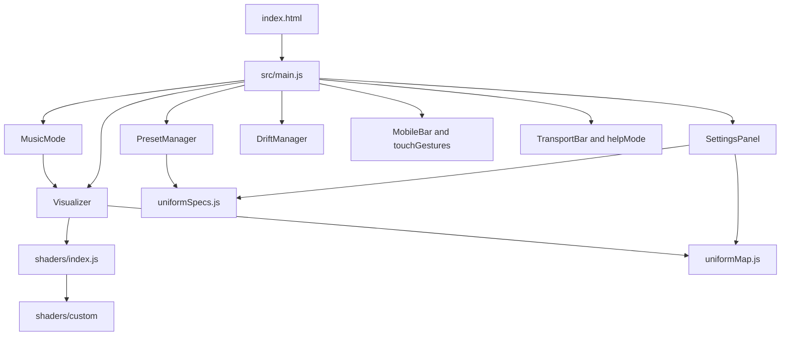

# Lobby Visualizer

Fullscreen WebGL picture for a lobby screen. It is being built for phones and tablets as well as desktop. The first use is a lobby, and the same picture can also run an interactive installation or a music visualizer.

Built with [Three.js](https://threejs.org/) and [Vite](https://vitejs.dev/). The live site is https://s2626.netlify.app/.

## Run locally

You need two free programs: **Git** (to download the project) and **Node.js** (it includes `npm`, which installs the project’s libraries).

### Install Git and Node.js

**macOS**

1. Install Git: open Terminal and run `git --version`. If Git is missing, macOS offers to install the command-line tools. You can also install it from https://git-scm.com/download/mac.
2. Install Node.js from https://nodejs.org/ (the LTS download). The installer includes `npm`.

**Windows**

1. Install Git from https://git-scm.com/download/win. Keep the default options.
2. Install Node.js from https://nodejs.org/ (the LTS download). The installer includes `npm`.
3. Use **Git Bash** or **PowerShell** for the commands below.

**Linux**

```bash
# Debian, Ubuntu, and similar
sudo apt update
sudo apt install git
# Then install Node.js LTS from https://nodejs.org/
# or, if your distro’s package is recent enough:
sudo apt install nodejs npm
```

Check that both tools answer:

```bash
git --version
node --version
npm --version
```

### Download the project and start it

```bash
git clone https://github.com/muffinmaker/lobby-visualizer-s2626.git
cd lobby-visualizer-s2626
npm install
npm run dev
```

`npm install` downloads the libraries the project needs. You only run it again after the project’s dependencies change.

`npm run dev` starts a local site. Open http://localhost:5173/ in a browser. Leave that terminal window open while you use it. Press Ctrl+C in the terminal when you want to stop.

From anywhere, `./viz.sh` (or the full path to that file) checks out `cursor/menu-gestures-7b1a`, pulls it, installs, and starts the dev server.

To make a production build:

```bash
npm run build
npm run preview
```

## Code structure

`index.html` is the page. Vite serves it and loads `src/main.js`, which wires the picture, the menu, and input together.



| Piece | What it does |
| --- | --- |
| `src/main.js` | Starts the app, connects the menu, presets, music, gamepad, logos, and gestures. |
| `src/Visualizer.js` | Three.js renderer, trail buffer, and the draw loop. |
| `src/shaders/index.js` | Built-in modes: Spirograph, Spiro Flow, Kaleidoscope, Flow Field, Metaballs, Wormhole, Ripple Layers. |
| `src/shaders/custom/` | Extra modes loaded at startup: Ribbons, Orb, Tunnel, Chamber, and Star Spin. |
| `src/midiInput.js` | Web MIDI. The map in Controls can point a knob or pad at a slider. |
| `src/uniformSpecs.js` | Slider ranges and defaults. Most sliders are 0–100. Counts and color channels keep their own units. |
| `src/uniformMap.js` | Turns those slider numbers into the values the shaders use. |
| `src/paletteGlsl.js` | Shared color palettes, including whiteness and blackness. |
| `src/SettingsPanel.js` | The menu. Display is first. Colors has its own folder. Folders start closed. |
| `src/PresetManager.js` | Built-in presets and smooth changes between them. |
| `src/DriftManager.js` | Slow motion of sliders: random, left to right, right to left, or ping-pong, with a 1–5 limit. |
| `src/MusicMode.js` | Microphone or tab audio, bands, and channels that can drive settings. |
| `src/TransportBar.js` | Desktop toolbar: mode, preset, save, tutorial, and help. |
| `src/helpMode.js` | After you click ?, hovering a control shows what it does. |
| `src/MobileBar.js` and `src/touchGestures.js` | Phone bar and touch controls. |
| `src/textOverlay.js` | On-screen text and the notepad. |
| `src/GamepadController.js` | Gamepad menu and playback. |

## Using it

Open the menu with **Space** (press it again to close). A second tap quickly after the first moves the menu to another corner. On a phone, double-tap the picture.

**Display** holds the everyday controls:

- **Quality** is Full, Balanced, or Lite. Lite is easier on a phone.
- **FPS lock** lowers resolution, then Quality, if the picture falls under the target (30 by default).
- **Ease (s)** is how long a slider change takes to arrive. 0 is instant. 10 seconds is very slow.
- **Post FX** is a filter on the finished picture: vignette, grain, chromatic fringing, contrast, hue, scanlines, posterize, and beat punch. Beat punch follows the music when capture is on.

**Modes** are the pictures. Orb, Tunnel, and Chamber are the 3D ones. Look around with drag, a trackpad scroll, or Look X/Y. Star Spin draws moving stars and spiro shapes, with a Noise slider like several of the other modes.

**Overlay** puts a second mode on top of the current one. Mix, Add, and Multiply change how they combine. Swap A and B trades which one is in front.

**Performance** (the P key, or the button in Controls) cycles presets on its own and drifts a few sliders, so the picture can run without hands.

**MIDI** (the M key) listens for a controller. Controls → MIDI map lists which knob (CC) or pad (note) does what. Defaults match a Launchkey Mini and a DDJ-FLX4 volume-style fader. Move a knob, then use “Put last CC in slot 1” if you want that knob saved.

**Trails** are the marks left by Spirograph, Spiro Flow, Flow Field, and Star Spin. Trail Decay at 100 keeps the color instead of fading it.

## On a phone

Phones and touch tablets get a bottom bar. A computer keeps the lobby menu. Double-tap the picture, or double-click on a computer, to open settings. Tap the preset number to cycle presets. Drag to look around, and pinch to zoom.

## Roadmap

See [IMPROVEMENTS.md](./IMPROVEMENTS.md) for the prioritized backlog.
